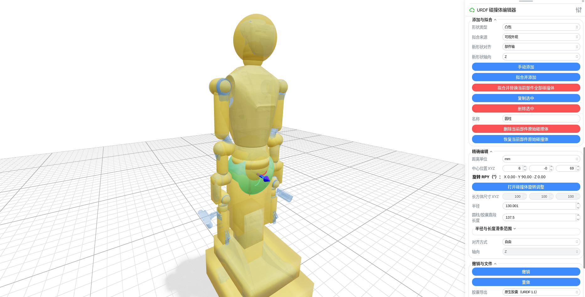

# URDF Collision Editor

[简体中文](README.md) | **English**

A URDF collision editor with a Chinese-language interface that runs locally in your browser. Inspect models link by link, fit spheres, boxes, cylinders, capsules, or convex hulls to geometry, and adjust individual collision shapes. The input URDF stays intact; saving produces a separate URDF and a YAML parameter file. ROS is not required at runtime.

## Preview



## One-command setup and launch

On Linux or macOS, run the following from the repository root. The script detects and installs `uv`, synchronizes dependencies from the lockfile, and passes any remaining arguments to the editor:

```bash
./deploy.sh --urdf xxx.urdf
```

To prepare the environment without starting the service:

```bash
./deploy.sh --setup-only
```

Without `--urdf`, the browser opens with the “Open Model” panel expanded so you can enter a URDF path manually:

```bash
./deploy.sh
```

Open the local URL shown in the terminal. The default is `http://127.0.0.1:8080`.

## Manual launch

Requires Python 3.11 or newer and [uv](https://docs.astral.sh/uv/). Run from the repository root:

```bash
uv sync
uv run urdf-collision-editor --urdf xxx.urdf
```

You can also supply additional options:

```bash
uv run urdf-collision-editor --urdf /path/to/robot.urdf \
  --package-dir /path/to/robot_package \
  --package-dir /path/to/ros_workspace
```

Repeat `--package-dir` to resolve `package://` mesh paths. The editor also searches for `package.xml` near the URDF. Use `--host` and `--port` to change the listening address and port; the defaults are `127.0.0.1` and `8080`. Only expanded `.urdf` files are supported. Expand Xacro files externally before opening them.

## Editing workflow

The interface labels below are translated for reference; the application UI is in Chinese.

1. Select a link and inspect its existing collision and visual geometry. Each link can contain multiple collision shapes.
2. Under “Add and Fit” (添加与拟合), choose the fitting source, shape type, alignment, and axis. Use “Fit and Add” or “Fit and Replace All Collisions for This Link” to generate shapes. Spheres, boxes, cylinders, and capsules can also be added manually; convex hulls must be fitted from valid source geometry. Fitted shapes are starting points that you can refine.
3. Adjust each shape's `origin`, dimensions, or radius relative to its link. Add, delete, replace, undo, redo, or restore the link's original collision shapes as needed.
   - “Delete Original Collisions for This Link” removes the link's source collisions from the working copy and final export while keeping newly added shapes. You can undo the operation or restore the originals.
   - “Delete Selected” removes only the collision shape currently selected in the list.
4. Check the workspace synchronization status, then use the save controls to choose a **new output directory**. Keep the exported `robot.urdf`, `collisions.yaml`, and required `assets/` together when moving or distributing the model.

The interface edits distances in **millimeters (mm)** and rotations in **degrees (°)** by default. Distances can also be displayed in meters. URDF and YAML files always store meters and radians. Radius and length sliders use absolute values; set their maximum range in millimeters under “Radius and Length Slider Range.” Sliders retain roughly a thousand steps for fine adjustment, and numeric fields accept any valid absolute value. The `origin` field's `xyz` is the position in the link's local coordinate system, and `rpy` is the collision shape's rotation relative to that link.

For fitting, “Free” alignment determines orientation from the geometry. “Link Axes” first transforms the source collision or visual geometry into the **owning link's local coordinate system**, then fits along those axes. Box edges align with the link's X/Y/Z axes; cylinders and capsules can use X, Y, or Z as their central axis. A cylinder or capsule's own length always follows its local Z axis, so the editor applies a fixed rotation to align that axis with the chosen link axis. Arbitrary rotation is locked in “Link Axes” mode; switch to “Free” to edit rotation. A sphere's orientation has no geometric effect. Convex hulls are stored as mesh resources and do not support “Link Axes” mode.

## Workspace, recovery, and export

Edits automatically synchronize to the session workspace, typically updating `state.json`, `working.urdf`, and `parameters.yaml` about 0.3 seconds after a change. These are temporary working copies: **automatic synchronization is not a formal save**. The original URDF is never overwritten. Saving gathers the URDF, YAML, and referenced resources, such as meshes, into the selected output directory. Resource paths in the URDF are relative to that directory so the exported model can be moved as a unit. Portable export reports an error if a referenced mesh or associated texture is missing; restore those resources before exporting.

When reopening a saved `robot.urdf`, the editor automatically loads the adjacent `collisions.yaml` if its recorded output URDF fingerprint exactly matches the file's contents. This restores editing metadata such as capsules, convex hulls, and axis alignment. It also displays the three primitives exported for a compatibility-mode capsule as one logical capsule again. If the URDF has since changed, the YAML is not applied automatically; use “Import YAML (Preview)” to review it before applying it.

After an unexpected exit, pass the original session workspace to `--recover`:

```bash
uv run urdf-collision-editor --recover /path/to/session-directory
```

Keep the entire workspace, including `source.urdf`, `session.json`, `state.json`, and generated mesh files. Recovery uses the session's source snapshot, but external meshes must still be accessible. If the source model has changed, review the recovered result and save it to a new directory. YAML parameter files record collision shapes and source-file fingerprints to help verify their origin. If fingerprints differ, manually confirm that the models match.

By default, “Compatibility” capsule export writes each capsule as one cylinder and two spheres for URDF readers that do not support `<capsule>`. Native mode writes `<capsule>` and sets the required URDF version to 1.1; the target tool must support that format. Convex hulls are exported as generated meshes referenced with `<mesh>`, rather than a built-in URDF convex-hull tag.

The main toolbar always provides “Open URDF Source Editor” and “Open Joint Angle Adjustment,” along with a light sun theme and a soft blue-gray moon theme. The source editor opens a movable, closable window with XML syntax highlighting. “Validate and Apply Source” checks the XML, the `robot` root element, and link names, then writes the content into a new session workspace and reloads it. It preserves both the initially opened URDF and the previous workspace so you can return to the earlier model. Joint angle controls use degree-based sliders and precise numeric inputs to preview movable joints without changing the URDF. For individual collision shapes, “Open Collision Rotation Adjustment” provides X/Roll, Y/Pitch, and Z/Yaw sliders and numeric inputs in degrees for free rotation. Rotation is locked for axis-aligned shapes and spheres.

## Scope and limitations

- Editing is limited to collision geometry; joint structure, inertia, and visual models are preserved.
- Input must be a parseable URDF. Xacro, SDF, and MJCF cannot be opened directly.
- Fitting requires valid three-dimensional source geometry. Coplanar, collinear, or empty meshes and missing resources may prevent fitting. You can add primitives manually instead.
- Automatic fitting is a geometric approximation. Check collision behavior in your target simulator or planner before use.

Development checks:

```bash
uv run pytest
uv run ruff check .
```

For project references and third-party notices, see [THIRD_PARTY_NOTICES.md](docs/THIRD_PARTY_NOTICES.md).
