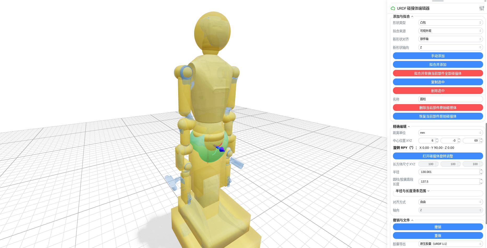

# URDF 碰撞体编辑器

**简体中文** | [English](README.en.md)

一个在本机浏览器中使用的中文 URDF 碰撞体编辑器。可按 link 查看模型，用球体、长方体、圆柱、胶囊或凸包拟合几何，并逐个调整碰撞体。输入 URDF 保持原样；保存时另行输出 URDF 和 YAML 参数文件。运行时不需要 ROS。

## 界面预览



## 一键部署与启动

Linux 或 macOS 在仓库根目录执行一次即可。脚本会检测并安装 `uv`、按锁定文件同步依赖，然后把其余参数传给编辑器：

```bash
./deploy.sh --urdf xxx.urdf
```

首次只准备运行环境而不启动服务：

```bash
./deploy.sh --setup-only
```

不传 `--urdf` 时，浏览器中的“打开模型”面板默认展开，可手动输入 URDF 路径：

```bash
./deploy.sh
```

浏览器打开终端显示的本机地址，默认是 `http://127.0.0.1:8080`。

## 手动启动

需要 Python 3.11 或更新版本及 [uv](https://docs.astral.sh/uv/)。在仓库根目录运行：

```bash
uv sync
uv run urdf-collision-editor --urdf xxx.urdf
```

也可以指定其他参数：

```bash
uv run urdf-collision-editor --urdf /path/to/robot.urdf \
  --package-dir /path/to/robot_package \
  --package-dir /path/to/ros_workspace
```

`--package-dir` 可以重复传入，用于解析 `package://` 网格路径；程序也会从 URDF 附近查找 `package.xml`。`--host` 与 `--port` 可调整监听地址和端口，默认分别为 `127.0.0.1` 和 `8080`。仅支持已展开的 `.urdf`，请先在外部展开 Xacro。

## 编辑流程

1. 选择一个 link，检查原有碰撞体和外观几何。一个 link 可包含多个碰撞体。
2. 在“添加与拟合”中选择“拟合来源”“形状类型”“新形状对齐”和“新形状轴向”，再用“拟合并添加”或“拟合并替换当前部件全部碰撞体”生成形状。球体、长方体、圆柱和胶囊也可“手动添加”；凸包必须从有效的源几何拟合生成。拟合结果是初始建议，可继续调整。
3. 调整碰撞体相对于所属 link 的 `origin`、尺寸或半径，并按需添加、删除、替换、撤销、重做或恢复该 link 的原始碰撞体。
   - “删除当前部件原始碰撞体”只会从工作副本和最终导出中删除该 link 的源 collision，会保留新添加的图形；可撤销或恢复。
   - “删除选中”则只删除当前列表中选定的一个碰撞体。
4. 检查工作区同步状态，完成后使用界面中的保存操作指定**新的输出目录**。导出的 `robot.urdf`、`collisions.yaml` 和所需的 `assets/` 应一起移动或分发。

界面默认以**毫米（mm）**编辑距离、以**度（°）**编辑旋转角度；距离仍可切换为米。URDF 与 YAML 始终以米和弧度存储。半径和长度恢复为**绝对值滑条**，最大范围可在“半径与长度滑条范围”中按毫米设置；滑条会保留约一千个刻度以便细调，数值框仍可输入任意有效绝对值。`origin` 的 `xyz` 是 link 局部坐标中的位置，`rpy` 是碰撞体相对于 link 的旋转。

拟合时选择“自由”会根据几何确定朝向；“部件轴”会先将源 collision 或 visual 几何转换到**所属 link 的局部坐标系**，再沿该坐标系的轴拟合。长方体边与 link 的 X/Y/Z 轴对齐；圆柱和胶囊可选择 X、Y 或 Z 作为中心轴。圆柱和胶囊的自身长度方向始终是局部 Z 轴：选择 link X、Y 或 Z 时，程序分别使用固定旋转将该局部 Z 轴对准所选方向。在“部件轴”模式下不能再任意旋转；切换到“自由”后可编辑旋转。球体的方向没有几何效果。凸包以网格资源存储，不提供“部件轴”模式。

## 工作区、恢复与导出

编辑操作会在会话工作目录中自动同步，通常在变更约 0.3 秒后更新 `state.json`、`working.urdf` 和 `parameters.yaml`。这些是临时工作副本，**自动同步不等于正式保存**。原始 URDF 不会被覆盖。正式保存会把 URDF、YAML 以及引用的网格等资源整理到选定输出目录，URDF 中的资源路径相对于该目录，便于整体搬移。若引用的网格或关联纹理缺失，便携导出会报错；请先补齐资源。

重新打开已保存的 `robot.urdf` 时，如果同目录的 `collisions.yaml` 记录的输出 URDF 指纹与文件内容完全一致，编辑器会自动读入 YAML，恢复胶囊、凸包和轴向等编辑信息；这也能把兼容模式导出的三个胶囊基本体重新显示为一个逻辑胶囊。如果 URDF 后来被改动，YAML 不会自动套用；可在界面中使用“导入 YAML（预览）”核对后再应用。

意外退出后，可把原会话工作目录传给 `--recover`：

```bash
uv run urdf-collision-editor --recover /path/to/session-directory
```

保留整个工作目录，包括 `source.urdf`、`session.json`、`state.json` 和生成的网格文件。恢复使用会话中的源文件快照，但外部网格仍须可访问。若源模型后来改变，请检查恢复结果，再另存到新目录。YAML 参数文件记录碰撞体及源文件指纹，可用于核对来源；指纹不匹配时应人工确认模型是否一致。

默认“兼容”胶囊导出会把每个胶囊写成一个圆柱和两个球体，便于使用不支持 `<capsule>` 的 URDF 读取器。选择原生模式则写入 `<capsule>`，并将需要的 URDF 版本设为 1.1；目标工具必须支持该格式。凸包作为生成的网格导出，使用 `<mesh>` 引用，并非 URDF 内建的凸包标签。

主工具栏始终显示“打开 URDF 源码编辑器”和“打开关节角度调整”，也提供浅色太阳与柔和蓝灰色月亮主题切换。前者会显示一个可移动、可关闭的独立窗口，编辑区本身支持 XML 语法高亮；点击“校验并应用源码”会检查 XML、`robot` 根节点及 link 名称，再将内容写入新的会话工作目录并重新加载。它不会覆盖最初打开的 URDF，也不会销毁原工作区，便于回退到编辑前的模型。后者用度数滑条和精确输入调整所有可动关节的预览姿态，不修改 URDF。碰撞体自身的“打开碰撞体旋转调整”使用 X/Roll、Y/Pitch、Z/Yaw 的滑条和数值输入以度编辑自由旋转；轴对齐和球体会锁定旋转。

## 范围与限制

- 编辑范围是碰撞几何；不修改关节结构、惯量或外观模型。
- 输入需为可解析的 URDF，Xacro、SDF 和 MJCF 不能直接作为输入。
- 拟合需要有效的三维源几何；共面、共线、空网格或缺失资源可能无法拟合。可改为手动添加基本体。
- 自动拟合是几何近似，导出前应在目标仿真器或规划器中检查碰撞效果。

开发检查：

```bash
uv run pytest
uv run ruff check .
```

项目参考与第三方说明见 [THIRD_PARTY_NOTICES.md](docs/THIRD_PARTY_NOTICES.md)。
